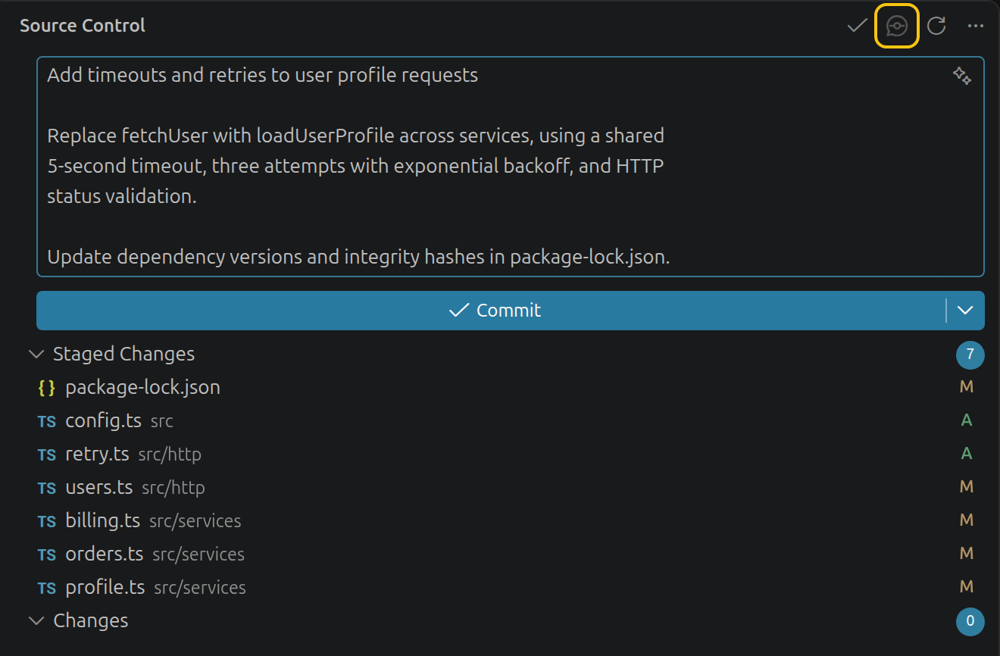

# Commit Draft

**AI commit messages for Codex & Claude.** Commit Draft writes Git commit messages in VS Code with the **Codex CLI** or **Claude Code** you already use. One click reads your changes and fills the Source Control message box with a draft you can review and edit.

> **Unofficial.** Not affiliated with or endorsed by OpenAI or Anthropic.

## Features

- **Uses your existing sign-in.** No API keys to paste; the extension stores no credentials.
- **Describes what you are about to commit.** Staged changes come first; tracked unstaged changes are used when nothing is staged.
- **Handles large changes.** Diffs of any practical size are condensed to fit instead of being rejected.
- **Never overwrites your work.** It asks before replacing a message, and if anything changes while it runs, the draft opens in a separate editor.
- **Conventional Commits, if you want them.** Turn on `feat:` / `fix:` style subjects with one setting.
- **No telemetry.** The AI tool runs read-only, in a temporary folder, with its tools turned off.

## Requirements

- VS Code 1.95 or later, with the built-in Git extension enabled
- One of these, installed and signed in:
  - [Codex CLI](https://learn.chatgpt.com/docs/codex/cli)
  - [Claude Code](https://code.claude.com/docs/en/setup)
- A local Git repository in a [trusted workspace](https://code.visualstudio.com/docs/editing/workspaces/workspace-trust)

## Getting started

1. Install the extension from the Visual Studio Marketplace, or install a `.vsix` file with **Extensions: Install from VSIX…**.
2. Check that your CLI works: run `codex` or `claude` in a terminal and sign in.
3. Open the Command Palette (`Ctrl+Shift+P`, or `Cmd+Shift+P` on macOS) and run **Commit Draft: Select AI Provider**. Codex is the default.
4. Stage the changes you want to commit.
5. Click the **Generate** button (the speech-bubble icon) in the Source Control title bar.
6. Review the draft, edit it if needed, and commit as usual.

To stop a request, click **Cancel** on the progress notification.

## Commands

| Command | What it does |
| --- | --- |
| **Commit Draft: Generate Commit Message** | Writes a draft for the current repository. With several repositories open, the toolbar button uses its own repository and the Command Palette asks you to pick one. |
| **Commit Draft: Select AI Provider** | Switches between Codex and Claude. |

## How it works

### Which changes are described

- **Staged changes**, if there are any. For a partially staged file, only the staged part is used.
- Otherwise, **tracked unstaged changes**. The progress notification tells you which one is used.
- New files must be staged first, and unsaved edits are not included, so save before generating.
- Binary files are described by name only.

### Large changes

A diff up to `commitDraft.maxDiffBytes` (256 KB by default) is sent in full. A larger diff is condensed to fit, and the progress notification says so:

- Every changed file is listed with its added and removed line counts.
- Small files keep their full patch. Long ones are shortened, with a note saying how many lines were left out.
- Lock files, minified files, source maps and test snapshots are listed but not sent.
- The AI tool is told the diff was condensed, so it describes the change as a whole.

Diffs over 32 MB are described from the file list alone.

### Your work is protected

- The extension never stages, commits, pushes or edits files.
- Replacing an existing message requires your confirmation.
- If your changes, your current commit or the message box change during generation, the draft opens in a separate editor instead.
- Cancelling or an error leaves your message untouched, and only one request per repository runs at a time.

## Settings

Open **Settings** and search for `commitDraft`.

| Setting | Default | Description |
| --- | --- | --- |
| `commitDraft.provider` | `codex` | `codex` or `claude` |
| `commitDraft.conventionalCommits` | `false` | Ask for Conventional Commits subjects such as `fix: …` |
| `commitDraft.codexPath` | `codex` | Codex executable name or absolute path, without arguments |
| `commitDraft.codexModel` | *(empty)* | Codex model; empty uses the CLI default |
| `commitDraft.claudePath` | `claude` | Claude executable name or absolute path, without arguments |
| `commitDraft.claudeModel` | *(empty)* | Claude model; empty uses the CLI default |
| `commitDraft.maxDiffBytes` | `262144` | Largest diff sent in full (1 KB to 1 MB); larger diffs are condensed |
| `commitDraft.timeoutSeconds` | `120` | How long to wait for the AI tool (10 to 600 seconds) |

The provider, path, model, size and timeout settings apply to your machine only, so a repository's workspace settings cannot change which program runs. Codex runs without your personal Codex configuration.

**Choosing `maxDiffBytes`:** a full 256 KB diff of generated TypeScript measured about 80,000 tokens with Codex and 150,000 with Claude. Larger values use more of your plan per large commit. Up to 1 MB fits Claude's context window; Codex models run out of context well before that.

## Privacy

- When you click **Generate**, the selected diff is sent to the AI provider you chose, under your own account, terms and usage limits. Check what is staged before you generate.
- The extension has no telemetry, stores no credentials, keeps no history and never logs your code.
- Each request runs in a new temporary folder, and your code is passed through standard input, not command-line arguments.
- Codex runs read-only and ephemerally, with shell tools, apps, plugins and web search turned off.
- Claude runs in safe mode, with its tools and MCP servers turned off and no saved session.
- Your organization's managed policies still apply, and the provider's own data retention rules are unchanged.

## Troubleshooting

| Problem | What to do |
| --- | --- |
| *Codex/Claude executable not found* | Check that the CLI runs in a terminal, then restart VS Code. If it is not on your `PATH`, set `commitDraft.codexPath` or `commitDraft.claudePath` to its full path; the error's **Open Settings** button takes you there. |
| *Use a native executable … not a .cmd or .bat shim* (Windows) | Install the provider's native `.exe` and set its full path. |
| *Codex/Claude reported an error: …* | The text comes from the provider. Common causes are an expired sign-in, an unknown model name or a usage limit. |
| *… did not finish within N seconds* | Try again, or increase `commitDraft.timeoutSeconds`. |
| *No tracked changes to describe* | Save your files and stage any new files. |
| *Resolve merge conflicts …* | Finish or abort the merge first. |
| The **Generate** button is missing | It appears only for Git repositories in a trusted workspace. You can also run the command from the Command Palette. |
| The draft opened in a separate editor | Something changed while it was generated. Copy it into the message box if it still fits. |
| Remote window (WSL, SSH, Dev Containers) | The extension runs in the remote environment, so install and sign in to the CLI there. |

## Known limitations

- Tested on Linux. Windows and macOS have not been tested yet, which is why the extension is marked Preview.
- Web-based and virtual workspaces are not supported.
- AI wording varies between runs. Always review the draft before committing.

## Contributing

Bug reports and pull requests are welcome; see [CONTRIBUTING.md](CONTRIBUTING.md). To report a security issue, follow [SECURITY.md](SECURITY.md). Release notes are in [CHANGELOG.md](CHANGELOG.md).

## License

[MIT](LICENSE)
